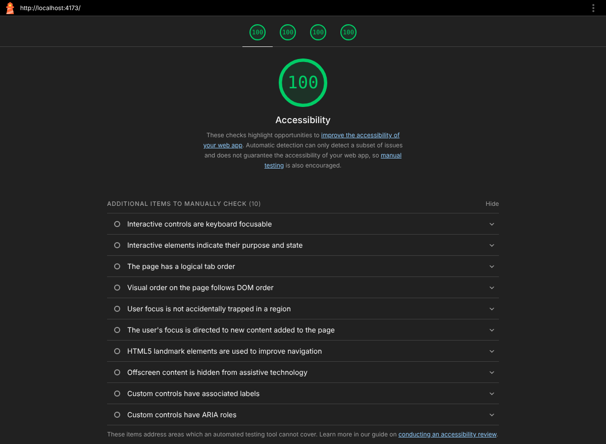

# Hringvegur: Island-Roadtrip-Planer

Kleine statische Webseite für ESA 1 im Modul **SED502 Frontend Development** (FernFH).

Die Seite stellt 14 Sehenswürdigkeiten entlang der isländischen Ringstraße vor. Besucherinnen und
Besucher können die Ziele nach Region, Kategorie und Freitext filtern und per Klick zu einem
eigenen Reiseplan hinzufügen. Der Reiseplan zeigt laufend, wie viele Ziele ausgewählt sind, wie
viel Aufenthaltszeit sich daraus ergibt, wie viele Regionen abgedeckt werden und welcher Punkt am
weitesten von Reykjavík entfernt liegt.



## Starten

```bash
npm install
npm run dev      # Entwicklungsserver
npm run build    # Typprüfung mit tsc und Production-Build mit Vite
npm run preview  # Production-Build lokal ansehen
```

## Projektstruktur

```
index.html        Semantische Seitenstruktur
src/types.ts      Interfaces und Union-Types (Stop, FilterCriteria, PlanSummary)
src/data.ts       Datensatz der Sehenswürdigkeiten
src/logic.ts      Reine Funktionen: Filtern, Suchen, Reiseplan berechnen
src/render.ts     DOM-Funktionen: Karten, Optionen und Reiseplan rendern
src/main.ts       Einstiegspunkt: Zustand und Event-Listener
src/style.css     Styling mit CSS Custom Properties
lighthouse.png    Screenshot des Lighthouse-Audits
reflexion.pdf     Reflexionsbericht
```

## Technische Entscheidungen

**Vite + TypeScript ohne Framework.** Vite liefert Entwicklungsserver und Build, so wie in Modul 01
eingerichtet. Für eine Seite dieser Größe ist kein Framework nötig. `npm run build` führt zuerst
`tsc` aus, ein Typfehler bricht den Build also ab.

**Strenge Compiler-Einstellungen.** `strict`, `noUnusedLocals`, `noUnusedParameters` und
`noUncheckedIndexedAccess` sind aktiviert, damit Fehler früh auffallen.

**Semantisches HTML.** `header`, `nav`, `main`, `footer`, `section`, `article`, `aside`, `figure`
und `figcaption` tragen die Struktur. Jede Sehenswürdigkeit ist ein `article` in einer Liste, der
Reiseplan eine geordnete Liste (`ol`), Kennzahlen stehen in Beschreibungslisten (`dl`). Ein `div`
wird nur als reiner Layout-Container ohne Bedeutung verwendet.

**Accessibility.**
- `nav` mit `aria-label="Hauptnavigation"`, Skip-Link zum Hauptinhalt, `lang="de"`
- Sections über `aria-labelledby` mit ihren Überschriften verknüpft
- Trefferanzahl und Reiseplan-Zusammenfassung als `aria-live="polite"`, damit Screenreader Änderungen ansagen
- Buttons in den Karten haben ein `aria-label` mit dem Namen des Ziels, z. B. „Gullfoss zum Plan hinzufügen“
- Nach einem Klick bleibt der Tastaturfokus auf dem Button derselben Karte, obwohl die Liste neu gezeichnet wird
- Die SVG-Illustration hat `role="img"` und einen `title`
- Sichtbarer Fokusrahmen über `:focus-visible`, Farbkontraste nach WCAG AA

**TypeScript-Konzepte.**
- Interfaces `Stop`, `FilterCriteria`, `PlanSummary` sowie Union-Types `Region` und `Category`
- Typisierte Funktionen, z. B. `filterStops(stops: Stop[], criteria: FilterCriteria): Stop[]` und `summarizePlan(plan: Stop[]): PlanSummary`
- Array-Methoden: `filter` (Filter, Entfernen aus dem Plan), `map` (Rendern), `find` (Ziel per ID), `some` und `reduce` (Kennzahlen des Reiseplans in einem Durchlauf)
- Generische Hilfsfunktionen `getElement<T>()` und `createElement<K>()` für typsicheren DOM-Zugriff
- Event Delegation: ein einziger Click-Listener auf der Liste statt einem Listener pro Button

**Trennung von Logik und Darstellung.** `logic.ts` enthält nur reine Funktionen ohne DOM-Zugriff.
Sie sind dadurch leicht nachvollziehbar und testbar. `render.ts` erzeugt Elemente mit
`createElement` und `textContent` statt `innerHTML`, so wird kein Text als HTML interpretiert.

**Gestaltung nur mit CSS.** Jede Kategorie hat eine eigene Akzentfarbe (Linie oben an der Karte und
Punkt im Tag). Die Karte bekommt dafür nur ein `data-category`-Attribut, die Farbe selbst steht im CSS.
Die Farben werden nur für Flächen und Linien verwendet, nie als einzige Information: die Kategorie steht
immer auch als Text daneben. Ab 64rem Breite steht der Reiseplan neben der Liste und bleibt per
`position: sticky` beim Scrollen sichtbar. Hover-Bewegungen sind nur aktiv, wenn im System keine
reduzierte Bewegung eingestellt ist (`prefers-reduced-motion`).

**Keine externen Abhängigkeiten zur Laufzeit.** Die Illustration ist ein Inline-SVG, Schriften kommen
aus dem System-Font-Stack. Die Seite lädt dadurch schnell und funktioniert ohne Netzwerkzugriff auf
Drittanbieter.

## Lighthouse

Audit mit Lighthouse 12.8 (Mobile-Profil) gegen den Production-Build (`npm run build` und
`npm run preview`): Accessibility 100, Performance 100, Best Practices 100, SEO 100.

## Hinweis zu den Daten

Entfernungen ab Reykjavík und Aufenthaltsdauern sind gerundete Richtwerte und dienen nur der
Demonstration.
